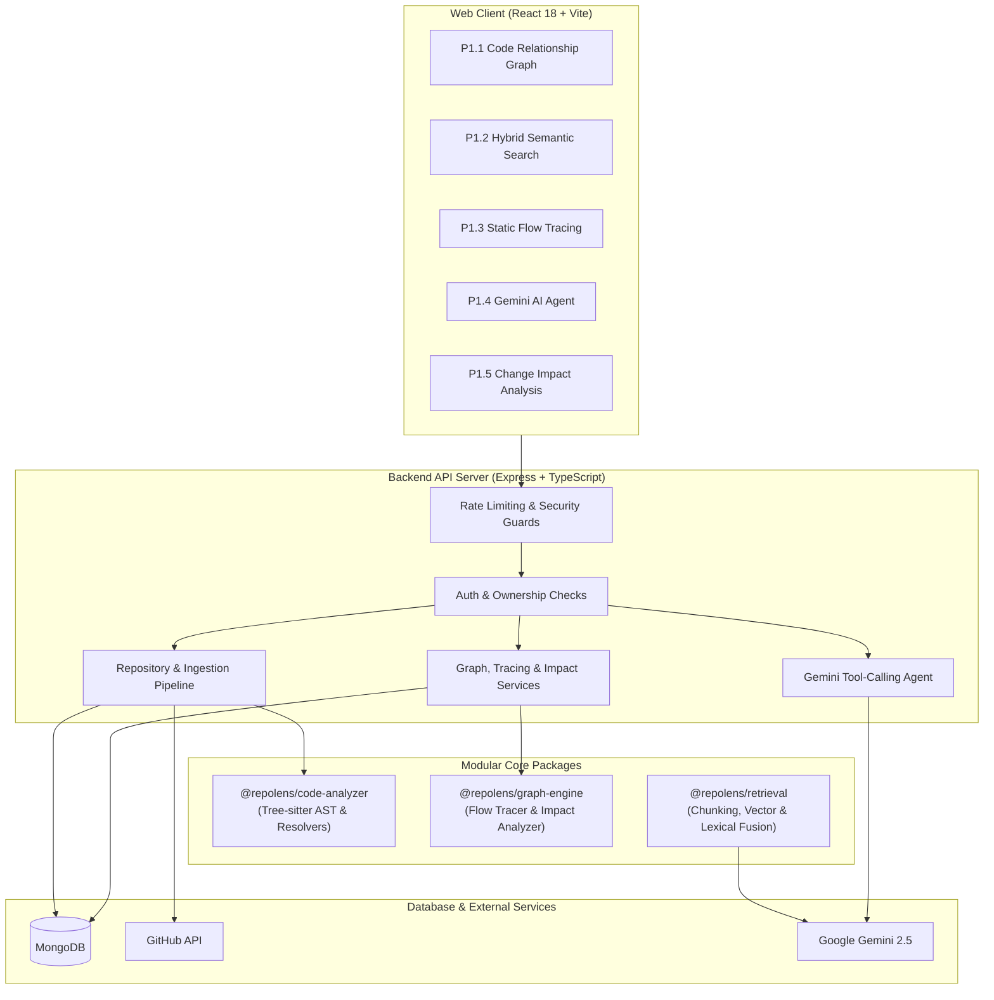

# RepoLens

> **AI-Powered Code Intelligence Platform**
> Deterministic static analysis, interactive architecture graphs, static execution flow tracing, hybrid semantic search, change impact analysis, and grounded AI pair-investigation.

[](https://www.typescriptlang.org/)
[](https://nodejs.org/)
[](https://react.dev/)
[](https://tailwindcss.com/)
[](https://vitest.dev/)
[](https://www.docker.com/)

---

## 🚀 Overview

RepoLens is a full-stack code intelligence platform designed to help software engineers rapidly comprehend unfamiliar codebases, locate relevant implementation details, trace request lifecycles, safely investigate architectural questions, and assess the blast radius of proposed code edits.

Built on the principle of **"Deterministic Static Analysis First, AI Reasoning Second"**, RepoLens extracts structural code relationships through Tree-sitter AST parsing, providing concrete evidence and verified source citations for every claim.



---

## 🌟 Core Product Features

### P1.1 Code Relationship Graph
- Interactive visual exploration of files, symbols, imports, and cross-file dependencies powered by React Flow.
- Neighborhood expansion with scoped BFS traversal and source code viewer drawer.

### P1.2 Semantic & Hybrid Code Search
- Structural AST-aligned code chunking preserves function, method, and class semantic boundaries.
- Hybrid search fusing 768-dimensional vector embeddings with lexical token matching using Reciprocal Rank Fusion ($k=60$).

### P1.3 Static Execution Flow Tracing
- Automatically discovers Express, Nest, and Fastify HTTP routes.
- Statically traces the end-to-end execution chain: **Route Definition → Middlewares → Controller → Service → Model**.
- Detects database operations and cycle protection bounds.

### P1.4 Gemini AI Agent with Read-Only Tools
- Investigates codebases autonomously using 7 sandboxed read-only tools: `readFile`, `searchCode`, `findReferences`, `getFileGraph`, `traceExecutionFlow`, `analyzeImpact`, `getRepositorySummary`.
- Multi-turn tool execution loop with strict 5-turn budget guardrails and verifiable `[file:line-range]` source grounding.

### P1.5 Change Impact Analysis
- Reverse dependency graph traversal identifies the full blast radius of modifying a symbol or file.
- Categorizes Layer-1 direct dependents, Layer-2+ transitive callers, and companion test suites with explainable call paths.

### Incremental Indexing & Reliability (Module 11)
- Multi-stage pipeline (`validate` → `resolve` → `discover` → `filter` → `graph` → `chunks` → `routes` → `publish`).
- Git tree blob SHA differencing updates only modified files, preserving prior index integrity on failure.

---

## 📁 Monorepo Layout

```
repolens/
├── apps/
│   ├── api/                    # Express REST API, auth & security middleware, controllers
│   └── web/                    # React 18, Vite, Tailwind CSS, React Flow client
├── packages/
│   ├── shared/                 # Central Zod schemas, TypeScript contracts, domain constants
│   ├── code-analyzer/          # Tree-sitter parsers, extractors, import/symbol resolvers
│   ├── graph-engine/           # In-memory graph structure, flow tracer, impact analyzer
│   └── retrieval/              # Chunking, vector embeddings, reciprocal rank fusion
├── workers/
│   └── indexing-worker/        # Background queue worker for asynchronous ingestion
├── fixtures/                   # Deterministic test repositories covering common patterns
├── docs/                       # Architecture, Security threat model, and API documentation
└── docker-compose.yml          # Multi-container orchestration (MongoDB, API, Web, Worker)
```

---

## 🛠️ Quick Start

### 1. Prerequisites
- **Node.js:** `>= 20.x LTS`
- **npm:** `>= 10.x`
- **Docker:** (Optional, for running MongoDB locally)

### 2. Configure Environment
Copy the environment template:
```bash
cp .env.example .env
```
Populate your environment variables:
```ini
PORT=4000
MONGODB_URI=mongodb://localhost:27017/repolens
WEB_ORIGIN=http://localhost:5173
GITHUB_TOKEN=ghp_your_github_token_here    # Optional, increases GitHub rate limits
GEMINI_API_KEY=your_gemini_api_key_here    # Required for live semantic search & agent
```

### 3. Start Local MongoDB
Start MongoDB with Docker Compose:
```bash
docker compose up -d mongodb
```

### 4. Install Dependencies & Build
```bash
npm install
npm run build
```

### 5. Launch Development Servers
In separate terminals:
```bash
# Terminal 1: Backend API (port 4000)
npm run dev:api

# Terminal 2: Frontend Web UI (port 5173)
npm run dev:web
```
Open [http://localhost:5173](http://localhost:5173) in your browser.

---

## 🐳 Docker Production Deployment

To run the complete production stack (Database, API, Web frontend, and Indexing Worker) in isolated containers:

```bash
docker compose up --build -d
```
- Web Application: [http://localhost:5173](http://localhost:5173)
- API Gateway & Health: [http://localhost:4000/api/health](http://localhost:4000/api/health)

---

## 🧪 Testing & Quality Assurance

RepoLens enforces 100% test pass rates across all packages before every release:

```bash
# Run unit & integration test suites across all workspaces
npm test

# Run strict TypeScript typechecks across all workspaces
npm run typecheck
```

---

## 📚 Documentation
- [Architecture Overview & Principles](docs/architecture.md)
- [REST API Specification](docs/api.md)
- [Security Threat Model & Defense](docs/security.md)

---

## 📄 License
MIT © 2026 RepoLens Team.
