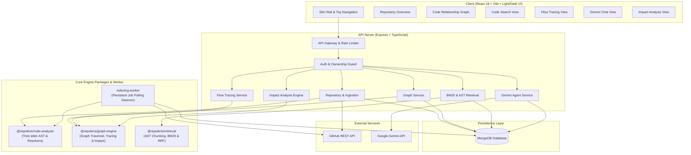

# RepoLens Architecture Overview

RepoLens is an AI-powered code intelligence platform designed for deterministic codebase analysis, interactive architecture visualization, execution flow tracing, zero-embedding hybrid code search, and grounded AI pair-investigation.



---

## 1. Monorepo Structure

```
repolens/
├── apps/
│   ├── api/                      # Express REST API, auth guards, controllers
│   └── web/                      # React 18, Vite, Tailwind CSS (Light/Dark), React Flow UI
├── packages/
│   ├── shared/                   # Domain schemas (Zod), shared types, constants
│   ├── code-analyzer/            # Tree-sitter AST parsing, declaration extractors, resolvers
│   ├── graph-engine/             # In-memory graph builder, BFS/DFS traversal, flow tracer, impact analyzer
│   └── retrieval/                # Structural AST chunking, Okapi BM25 scorer, RRF ranking
├── workers/
│   └── indexing-worker/          # Persistent background polling daemon for async ingestion
├── docs/                         # Architecture, security, and API documentation
└── fixtures/                     # Deterministic test repositories
```

---

## 2. Core Architectural Principles

1. **Deterministic Static Analysis First, AI Second:** All relations (imports, calls, inheritance, route definitions) are resolved via Tree-sitter AST parsing and symbol resolution prior to invoking AI models.
2. **Zero-Embedding Code Search:** Code retrieval relies on AST-aligned structural chunking, identifier-aware tokenization, and Okapi BM25 + Reciprocal Rank Fusion rather than external vector embedding calls, keeping search deterministic and fast.
3. **Strict Citation Grounding:** The Gemini AI agent is equipped with read-only investigation tools (`readFile`, `searchCode`, `traceExecutionFlow`, `analyzeImpact`, etc.) and cites exact file ranges (`[file:line-range]`).
4. **Persistent Worker & Atomic Versioning:** The `indexing-worker` polls continuously for queued repository jobs (`validate_repository` → `resolve_commit` → `discover_tree` → `filter_files` → `discovered`) with graceful `SIGINT`/`SIGTERM` shutdown and atomic index version updates.
5. **Untrusted Code Security:** Repositories are analyzed purely statically without executing code, installing dependencies, or running build scripts.

---

## 3. Data Flow & Subsystems

### P1.1 Code Relationship Graph
- Parses AST import statements, exports, and declarations.
- Builds file-to-file and symbol-to-symbol directed edges.
- Supports scoped neighborhood retrieval with clamped BFS depth and interactive React Flow inspection.

### P1.2 Zero-Embedding Code Search
- Chunks source code aligned to AST structural boundaries (functions, classes, methods, routes).
- Scores queries with Okapi BM25, AST entity matching, and query expansion, fused via Reciprocal Rank Fusion ($k=60$).

### P1.3 Static Execution Flow Tracing
- Discovers HTTP routes (`GET`, `POST`, `PUT`, `DELETE`, etc.).
- Traces execution chain: Route Definition → Middlewares → Controller → Service → Database Model.
- Bounded traversal with cycle detection.

### P1.4 Gemini AI Agent with Read-Only Tools
- Investigates codebases using 7 structured read-only tools over SSE streaming.
- Multi-turn function calling with budget enforcement (max 5 iterations per turn).
- Cites verifiable source locations.

### P1.5 Change Impact Analysis
- Reverse dependency graph traversal.
- Computes Layer-1 directly affected files, Layer-2+ transitive callers, and companion test suites with explainable traversal paths.
